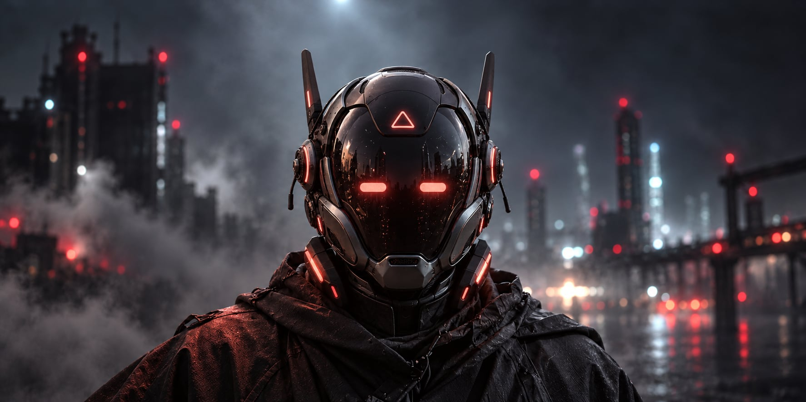
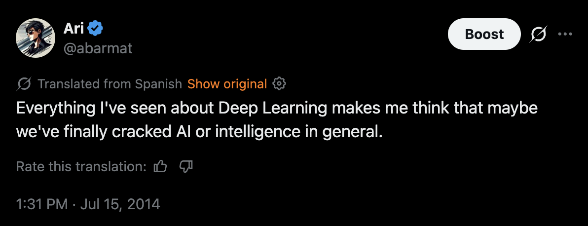

Nearly ten years ago I shared with some friends that we might all be wearing masks in the future. That prediction came true when the pandemic hit, but it was not the kind of mask I was thinking about!

At that time I was playing with deep learning. I watched how quickly neural networks were breaking all records in image recognition, some early forms of style transfer and followed AlphaGo's progress. It felt we discovered something really powerful, and wondered what if that trend continued.

---

Sensors are already everywhere, and they will increasingly be powered by AI. Today, the most prominent one is the camera. It’s not easy to use a laptop at airports, hotels, bars or cafés without being recorded. A camera can expose enough detail to show what you type. Now, we can analyze and cross-reference the data at scale.

We have mobile devices in our pockets, most of them, in theory, are not actively recording unless you have been hacked or you installed a malicious app.

An avalanche of new devices that supersede the mobile will soon become more common. Wearable cameras that read your face and gestures. They'll pick up cues about your mood, catch if you are lying or nervous much better than any human. Your AirPods-like devices will simultaneously translate conversations, record them all, isolate them, transcribe, and then amplify whatever you want to listen to.

We'll increasingly rely on physical masks. It's not the future I'd love to live in, but the adoption of masks might look like the adoption of computers, if you don’t use one you will be at a disadvantage.

A mask can get you a lot. It can hide your emotions but at the same time analyze the world around you as it integrates all the vision and audio information paired with a neural network. You could have superpowers: vision beyond the visible spectrum, or choosing what to hear. The mask allows new forms of privacy, like talking to anyone using an encrypted channel.

There will be open-source masks, with parts built as modules that people can attach to expand its capabilities. We'll also see the very fancy ones, "hand-crafted" specially for you that will signal status.

---

Maybe showing your face will become an act of trust. We will take our masks off around friends, at home, with people we believe will just use human judgment. Our ordinary world could become a form of intimacy.
